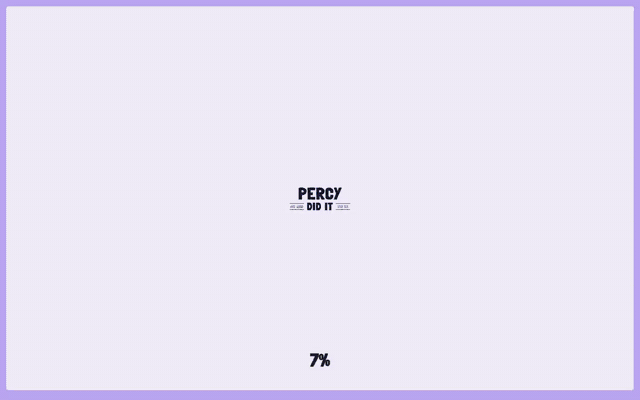

# Percy Did It

Situs brand untuk **Percy Did It**, soda buah prebiotik fiktif dengan tema "tersangka kriminal". Empat rasa, empat karakter buah berkacamata, satu tagline: *suspiciously fizzy*. Ditujukan sebagai contoh situs produk minuman yang playful dan penuh animasi scroll. Ini rebuild orisinal yang terinspirasi tampilan dan perilaku sebuah situs referensi: teks, logo, gambar, produk, warna, dan kodenya dibuat baru.

## Halaman

| File | Isi |
|---|---|
| `index.html` | Beranda: hero maskot, slider 4 rasa, kaleng meletup, 6 panel manfaat, testimoni yang berbalik jadi daftar artikel, penutup |
| `midnight-berries.html`, `velvet-currant.html`, `glacier-melon.html`, `electric-citrus.html` | Detail produk: huruf raksasa, komposisi, tabel gizi, pilihan 12oz / 4 pack, produk lain |
| `our-story.html` | Cerita brand: polaroid yang dikocok, pernyataan tiap karakter, nilai perusahaan dengan fisika |
| `case-files.html` | Daftar 12 artikel dengan hero tipografi |
| `case-files/*.html` | 12 halaman artikel |
| `press.html` | Daftar liputan dan kontak media |
| `contact.html` | Form kontak |
| `privacy-policy.html`, `terms-conditions.html` | Halaman legal |
| `404.html` | Halaman tidak ditemukan |

## Fitur dan interaksi

- Preloader dengan hitungan persen yang menyusut menjadi header (dilewati saat pindah halaman di dalam situs).
- Smooth scroll, animasi yang mengikuti posisi scroll, teks muncul per huruf dan per baris.
- Hero: buah melayang dengan parallax dan menjauh dari kursor, maskot berganti-ganti.
- Canvas di beranda: kaleng bergetar, terbuka, lalu menyemburkan buah, es, dan gelembung.
- Teks melengkung yang terdorong kecepatan scroll.
- Fisika di halaman cerita: label dan bentuk jatuh, bisa diseret, menjauh dari kursor.
- Hero Case Files: gerakkan kursor untuk melempar karakter buah.
- Menu produk (hover), pencarian, menu mobile dengan submenu, tombol magnetik, kursor khusus.
- Form kontak: validasi dan pesan sukses di sisi browser saja (tidak mengirim data).
- Transisi antarhalaman, responsif (desktop, tablet, ponsel), dan mengikuti `prefers-reduced-motion`.
- Tidak ada sound.

## Teknologi

HTML, CSS, dan JavaScript native. Tanpa framework, library, atau build step. Font lokal: **Londrina Solid Black** (judul) dan **BenchNine Bold** (teks). Keduanya pengganti gratis untuk font referensi yang lisensinya tidak jelas, dengan metrik disesuaikan lewat `@font-face`.

## Menjalankan

Buka `index.html` langsung di browser. Tidak butuh server.

## Struktur

```
├── index.html, our-story.html, case-files.html, press.html, contact.html
├── midnight-berries.html, velvet-currant.html, glacier-melon.html, electric-citrus.html
├── privacy-policy.html, terms-conditions.html, 404.html
├── case-files/          12 artikel
├── css/style.css        semua gaya
├── js/
│   ├── motion.js        easing, timeline, scroll, pemecah teks
│   ├── site.js          header, menu, dan logika tiap halaman
│   └── physics.js       mainan fisika di our-story
├── assets/
│   ├── fonts/  cursor/  img/
└── docs/preview/        homepage.gif, hero.png
```

## Mengedit

- **Teks**: langsung di file HTML. Header dan footer berulang di setiap halaman, jadi ubah di semua file.
- **Warna**: variabel di `:root` pada `css/style.css` (`--body`, `--light`, `--dark`, `--c1` sampai `--c4`).
- **Gambar**: timpa file di `assets/img/` dengan nama yang sama. `mascot-`, `can-`, `pack-`, `news-`, `float-`, `cue-`, `icon-` perlu latar transparan.
- **Nilai di kotak fisika**: atribut `data-values` pada `<canvas>` di `our-story.html`.
- **Hasil pencarian**: blok `#search-index` di setiap halaman.

## Perlu diganti sebelum dipakai

- Nama brand, tagline, perusahaan (Good Trouble Drinks Co.), kota, dan tahun berdiri
- Email `hello@percydidit.example`
- Tautan media sosial dan perusahaan (masih `#`); tombol "buy now" / "add to cart" mengarah ke `contact.html`
- Testimoni, artikel, komposisi, dan angka gizi: semuanya karangan
- Teks privasi dan syarat: contoh, bukan dokumen hukum

## Kredit aset

- Gambar: dihasilkan AI (Nano Banana via Google Flow), latar dipotong manual dengan chroma key
- Ikon, logo, kursor, bentuk: SVG buatan sendiri
- Font: Londrina Solid dan BenchNine (Google Fonts, SIL Open Font License)

## Keterbatasan

- Video hero dan urutan frame kemasan di referensi tidak bisa diakses saat riset, jadi animasi maskot dan kaleng meletup adalah tafsir sendiri.
- Ikon animasi di hero Case Files dibuat ulang sebagai SVG + CSS.
- Teks pada gambar kaleng dan kemasan adalah hasil AI, bukan label siap cetak; beberapa huruf "DID IT" tertutup karakter.
- Foto artikel memakai kaleng polos tanpa label.
- Kode fisika sederhana, bukan mesin fisika penuh.
